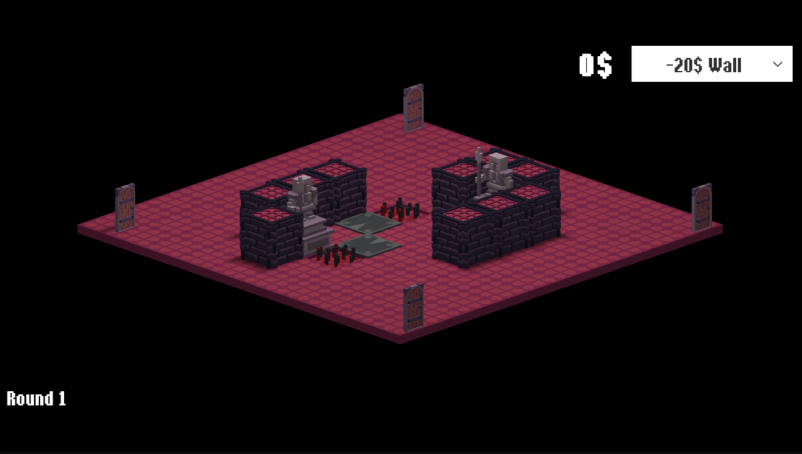
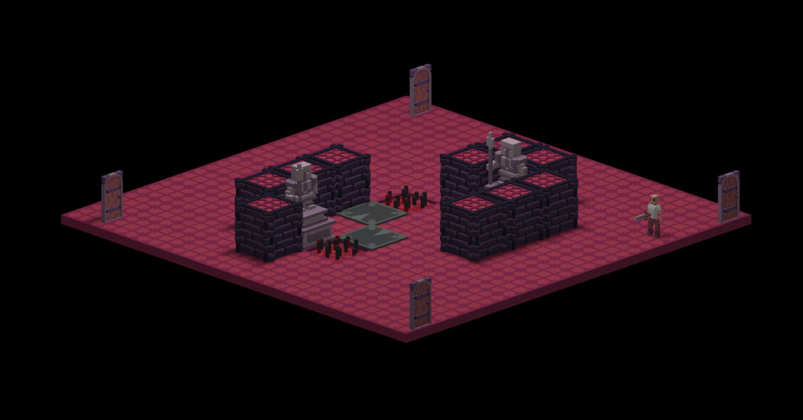
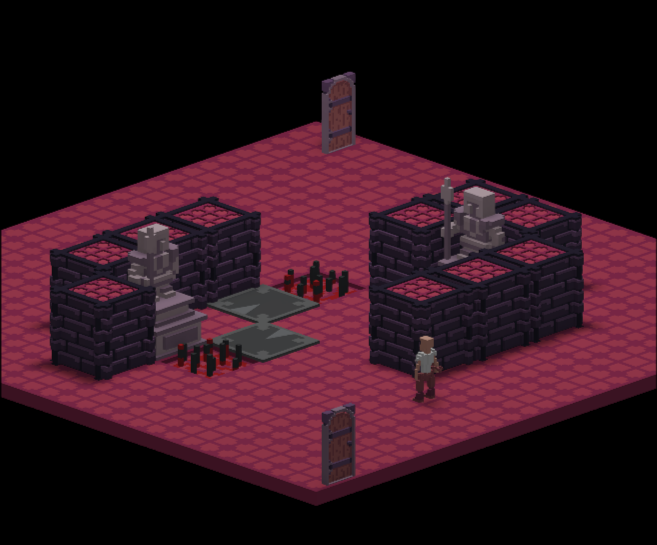

# Greedy Adventurers

This repo contains the code for a game made in about one week. You play as the "boss" of a dungeon, and you need to prevent the hero from reaching your treasure. You do this by shaping the layout and traps placed in the dungeon in order to most effectively ward off the adventurer.

This game was partially inspired by an old card game called [Boss Monster](https://www.brotherwisegames.com/bossmonster) by Brotherwise Games.

## Screenshots

## Credits

Most voxel art is taken from: https://austin-io.itch.io/voxel-dungeon-set